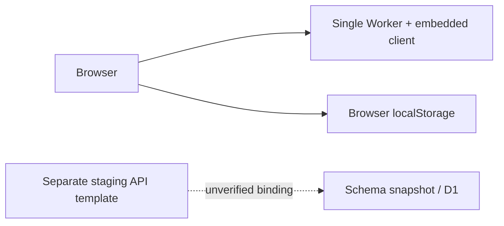

# Verified baseline — 17 November 2026

Repository: pixelgig/gst-desk, public, main at 3536eec. Clean clone; separate portable desktop project and private reports outside this checkout are untouched.

The production entrypoint configured in wrangler.jsonc is cloudflare/workers/gst-desk-preview/worker.js. It embeds the client in a single string. No package manifest, lockfile, automated tests, migration runner or deployment workflow existed at baseline. Configuration contains no D1 or R2 bindings. Deployment branch, live bindings, usage, Access policies and recovery snapshot remain unverified. README states pushing does not deploy.

The staging API is a sanitized reference, not deployment configuration. database/schema.snapshot.sql is structure only. Browser localStorage remains the principal persistence mechanism. Existing runtime parsing dependencies use a CDN. Valmo proxy authorization is unverified; it must not be described as an authorized integration.

Live Cloudflare settings were subsequently inspected read-only: gst-desk-preview has **zero bindings**; gst-desk-api-staging has a D1 binding named DB. The existing gst-desk-db reports 106,496 bytes. R2 bucket listing returns code 10042, requiring R2 activation in the dashboard. Subscription inspection returns 403 because the connected OAuth session cannot read billing. No billing tier or remaining quotas can be certified from this connection.

No customer data, service activation, production migration or deployment occurred during this baseline audit.
