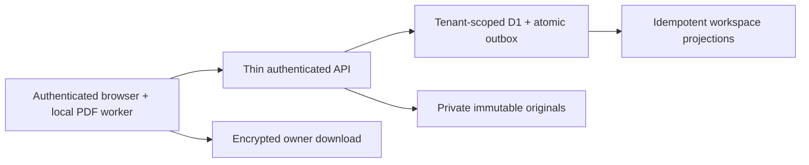

# Target and cutover gates

The new intake migration is additive against the checked-in legacy schema. It is locally tested SQLite, not proof of a deployed D1 migration. Preserve legacy routes and data until an isolated staged cutover passes.

Document storage protocol: reserve a pending metadata row and quota capacity; use a randomized tenant-scoped opaque object key; stream bounded original bytes to private storage; verify checksum and byte count; mark uploaded; accept versioned client extraction; require reviewer confirmation; atomically batch normalized rows, audit decision, idempotency response and outbox. Do not mark approved before the batch succeeds. Objects attached only to pending rows remain unavailable through download routes. Reconcile expired pending reservations against storage before deleting anything. Never delete an object referenced by approved metadata. Retain failed jobs for retry. Concurrent duplicate requests must resolve using tenant/hash and semantic unique constraints, not a client-only lookup.

Separate roles for billing/shipping, tax invoices/credit notes, document source facts/estimates and settlements/bank receipts. No stock movement on document upload. Consumers record event receipts in the same transaction as their projection updates. Pagination uses indexed business/date/id cursors; do not scan all PDFs in a Worker.

Unimplemented gates: authenticated API, bounded storage writes, quotas, extraction UI, actual D1 batch tests, event consumers, encrypted backup, R2 orphan recovery, cross-device E2E and deployment verification. Do not expose these tables through generic arbitrary SQL endpoints.
